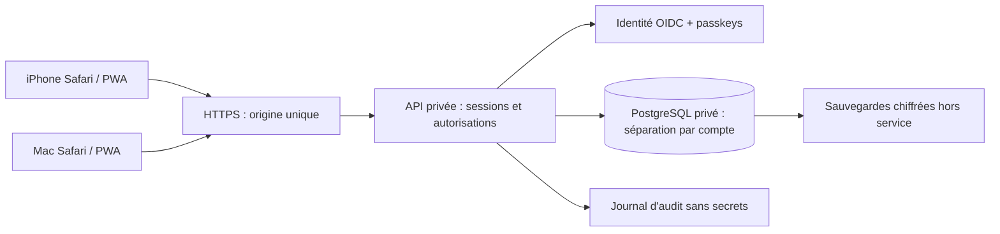

# Connexion privée et synchronisation — proposition à valider

État : conception seulement, aucun service créé, aucun abonnement souscrit.
Le trading reste exclusivement fictif, sans clé bancaire ni clé exchange.

## Décision d'architecture

Conserver la PWA et ses données actuelles. Ajouter une API privée sur la même origine via un reverse proxy, une base PostgreSQL privée et un fournisseur d'identité compatible OIDC et passkeys. Choisir le fournisseur et son budget après comparaison des tarifs réels, sauvegardes incluses, région UE, exportabilité et procédures de récupération. Ne pas déployer une base gratuite sans vérifier sa rétention et son expiration. Le site statique public peut rester une page de présentation ; toutes les routes et données du compte doivent être protégées côté serveur.

## Authentification et récupération

- Inscription fermée : compte propriétaire autorisé explicitement ; aucune inscription publique automatique.
- OIDC Authorization Code + PKCE ; vérifier signature, issuer, audience, nonce, state, expiration et URI de retour exacte. Jetons uniquement côté serveur.
- Passkeys WebAuthn : challenge aléatoire, à usage unique et à durée limitée ; RP ID et origine exacts ; `userVerification: required`. Ajouter une seconde passkey ou des codes de récupération hors appareil.
- Face ID / Touch ID intervient localement dans iOS/macOS ; le serveur reçoit une preuve cryptographique, aucune donnée biométrique. Il ne peut pas garantir que Face ID soit utilisé plutôt qu'un code appareil. Une passkey synchronisée par iCloud peut simplifier l'accès entre appareils ; elle ne synchronise pas les portefeuilles de l'application.
- Cookies `__Host-shimix-session`, `Secure`, `HttpOnly`, `SameSite=Lax`, `Path=/`, sans Domain. Renouveler après connexion et action sensible ; sessions serveur révocables, durée absolue et inactivité limitées. Pas de jetons dans localStorage.
- Limitation de débit, erreurs de connexion non discriminantes, anti-CSRF sur mutations, contrôle Origin, aucune CORS avec origine arbitraire et credentials.
- Réauthentification forte avant restauration, export global, ajout d'appareil et modification de récupération. Prévoir perte d'iPhone, perte de passkey et révocation à distance.

## Modèle de données et API

Tables proposées : `accounts(id, oidc_subject unique)`, `portfolios(id, account_id, revision, currency, simulation_only)`, `snapshots(portfolio_id, revision, payload, checksum, created_at)`, `events(id, account_id, portfolio_id, idempotency_key unique, type, payload, created_at)`, `sessions`, `audit_events`.

Montants en unités monétaires entières et quantités en décimaux bornés (pas de float pour comptabilité serveur). `simulation_only=true` imposé par contrainte ; aucune route d'ordre réel. Les règles de risque sont contrôlées sur le serveur, pas par le coach ni le navigateur. Un seul moteur écrit chaque portefeuille. Le robot public reste une simulation distincte du compte privé.

Endpoints à implémenter et tester :

| Route | Protection et contrat |
| --- | --- |
| `GET /api/me` | Session valide, compte autorisé, `Cache-Control: no-store` |
| `GET /api/portfolios/:id` | Filtre `account_id` serveur + RLS, jamais basé sur un identifiant envoyé seul |
| `PUT /api/portfolios/:id` | Schéma strict, taille limitée, CSRF, `If-Match: revision`, réponse `409` en cas de conflit |
| `POST /api/events` | Clé d'idempotence et transaction SQL, pas de double opération après reconnexion |
| `POST /api/backups/restore-preview` | Réauthentification, validation complète en staging, comparaison et résumé sans écriture active |
| `POST /api/backups/restore` | Confirmation du résumé, snapshot préalable et restauration transactionnelle auditée |
| `POST /api/sessions/revoke` | Propriétaire uniquement, révocation immédiate côté serveur |

La RLS est une défense supplémentaire ; tester systématiquement accès croisés à deux comptes. Ne jamais mettre une clé d'administration de base dans la PWA.

## Migration sans perte et synchronisation

1. Exporter une sauvegarde chiffrée depuis chaque appareil ; vérifier sa restauration sur un profil vierge. Garder les originaux et leurs empreintes.
2. Importer une copie dans un espace de staging privé après validation des schémas ; ne jamais effacer localStorage automatiquement.
3. Présenter une comparaison des soldes, positions et journaux des deux appareils ; ne pas sommer ou écraser les portefeuilles silencieusement.
4. Enregistrer une révision initiale puis activer le compte privé seulement après recette. Synchroniser à l'ouverture/reconnexion et après chaque mutation confirmée serveur.
5. Hors ligne : lecture du dernier snapshot avec date et état « non synchronisé » ; aucune opération autonome ni restauration silencieuse. En cas de `409`, présenter le conflit ; aucune règle « dernier appareil gagnant ».
6. Service worker limité au shell public, exclusion totale des routes `/api/`, sessions, exports et réponses privées. Effacement des caches privés à la déconnexion, sans supprimer une sauvegarde conservée explicitement par l'utilisateur.

## Sauvegardes et exploitation

- Base chiffrée au repos, TLS vérifié jusqu'à la base ; identité de service à privilèges minimaux.
- Sauvegardes quotidiennes, objectif proposé RPO 24 h et RTO 4 h à valider. Rétention proposée 30 quotidiennes et 12 mensuelles selon budget ; copie hors service.
- Chiffrement authentifié, chiffrement par enveloppe ; clé maîtresse dans un coffre distinct de la sauvegarde. Rotation et procédure de récupération testées. L'export local à mot de passe ne remplace pas cette protection serveur.
- Test mensuel de restauration en environnement isolé, comparaison de comptabilité et contraintes, mesure RTO. Ne jamais restaurer directement dans la production pour « tester ».
- Alertes sur échec de sauvegarde, échec de restauration, accès refusés répétés et rupture de synchronisation ; journaux sans mots de passe ni tokens.

## Recette bloquante

Valider sur iPhone et Mac réels : connexion, ajout de passkey, second appareil, révocation, expiration, perte de session, récupération, conflits, reconnexion hors ligne et restauration. Tester IDOR, CSRF, XSS, injection, brute force et isolation de compte. Faire relire l'implémentation et effectuer un audit d'intrusion indépendant avant de qualifier le compte de sécurisé. Cette architecture n'autorise aucune activité avec argent réel.
